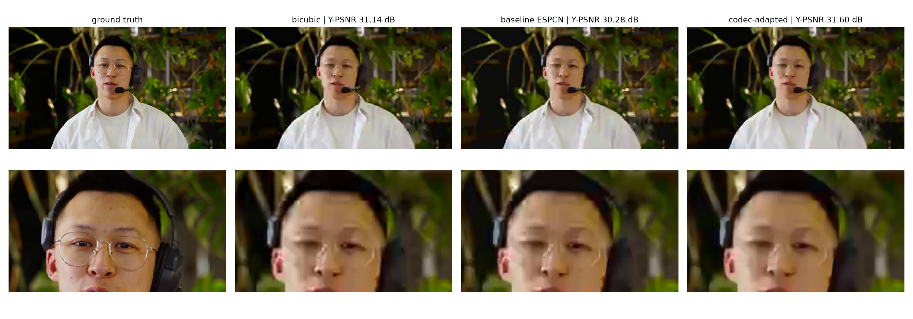
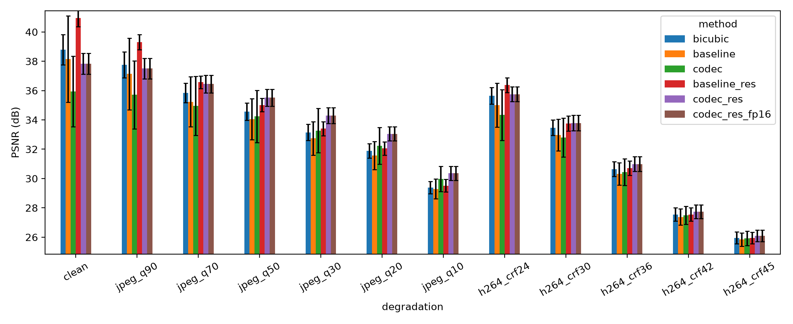

# Codec-Adapted Real-Time Video Super-Resolution

**A 21K-parameter ESPCN that upscales low-bitrate video 2x and suppresses JPEG / H.264 compression artifacts, at 60+ FPS end to end.**

   



*Held-out clip, H.264 CRF 38, 320x180 → 640x360. Left to right: ground truth, bicubic, standard ESPCN, **ours**. Bottom row is a zoomed crop; Y-PSNR is in each title.*

**Demo video:** [Watch on Google Drive](https://drive.google.com/file/d/11pM-2tb0tJ6gZHVJxKAJb1DoDb6QG1mg/view?usp=sharing) (81 s: bicubic vs plain ESPCN vs our model, live)

Video calls and live streams squeeze frames into low resolution and heavy compression, causing blocking, ringing and blur. Large super-resolution models are too slow for live video, and the lightweight ESPCN, trained on clean bicubic data, does not help on compressed input. This project retrains ESPCN on realistically compressed frames and deploys it with ONNX Runtime (FP16) in a live OpenCV pipeline.

## Highlights

- **+0.9 to +1.2 dB PSNR over bicubic** at JPEG Q20-Q50 (+0.5 to +1.0 dB over a controlled baseline), with SSIM up by 0.01-0.03.
- **Small, consistent H.264 gains** (+0.1 to +0.3 dB at CRF 30-45).
- **Real time:** 1.37 ms per frame on an RTX 3050 Laptop GPU (ONNX Runtime FP16); **63.9 FPS end to end, 0 dropped frames over a 15-minute test.**
- **No GPU needed:** 6.7 ms per frame on CPU, 2.5x faster than PyTorch.
- **Honest limits:** it is specialised for compressed input and is below bicubic on clean or very mild input ([Limitations](#limitations)).

## Results

Evaluated on **480 frames from two held-out clips never used in training**, Y-channel metrics, 2x upscale. The controlled baseline uses the identical architecture and training recipe but is trained on clean data only, so the only difference is the training degradation. (The plain ESPCN trained on clean data is below bicubic at every level, by 0.1 to 0.65 dB.)

| Input | Bicubic PSNR | **Ours** | Δ vs bicubic | Δ vs controlled baseline | Δ SSIM vs bicubic |
|---|---|---|---|---|---|
| Clean | 38.79 | 37.84 | -0.96 | -3.11 | -0.020 |
| JPEG Q90 | 37.77 | 37.51 | -0.26 | -1.80 | -0.011 |
| JPEG Q70 | 35.84 | 36.45 | +0.61 | -0.12 | +0.001 |
| JPEG Q50 | 34.58 | 35.51 | **+0.94** | +0.50 | +0.009 |
| JPEG Q30 | 33.15 | 34.30 | **+1.15** | +0.89 | +0.019 |
| JPEG Q20 | 31.88 | 33.05 | **+1.17** | +0.99 | +0.027 |
| JPEG Q10 | 29.38 | 30.36 | **+0.97** | +0.84 | +0.035 |
| H.264 CRF 24 | 35.65 | 35.75 | +0.11 | -0.62 | -0.005 |
| H.264 CRF 30 | 33.47 | 33.79 | +0.32 | +0.03 | +0.001 |
| H.264 CRF 36 | 30.65 | 30.99 | +0.34 | +0.28 | +0.007 |
| H.264 CRF 42 | 27.55 | 27.74 | +0.19 | +0.19 | +0.010 |
| H.264 CRF 45 | 25.96 | 26.09 | +0.13 | +0.14 | +0.015 |

*PSNR in dB. Source: `results/csv/quality_summary.csv`. With two test clips the confidence intervals in the CSV are optimistic.*

**Speed** (model only, 180x320 input, median of 200 runs):

| Runtime | Device | Precision | Latency | FPS |
|---|---|---|---|---|
| PyTorch | CPU | FP32 | 16.9 ms | 59 |
| ONNX Runtime | CPU (8 threads) | FP32 | 6.7 ms | 149 |
| ONNX Runtime | RTX 3050 Laptop | FP32 | 1.73 ms | 578 |
| ONNX Runtime | RTX 3050 Laptop | **FP16** | **1.37 ms** | **730** |

FP16 is about 1.26x faster than FP32 on the GPU and matches its output to within 0.01 dB. For a model this small, PyTorch on the GPU is as fast as ONNX Runtime; ONNX's advantage is CPU speed and portability. Dynamic INT8 quantization was much slower than FP32 on this hardware.
**End-to-end** (`live_stream.py`, display on, 15 minutes): 57,476 frames, 0 dropped, median 5.9 ms, p95 10.7 ms, **63.9 FPS wall-clock**.



## How it works

1. **Luminance only.** Each frame is converted to YCrCb; the network upscales Y, and Cr/Cb are upscaled with bicubic and merged back.
2. **Model** (`models/espcn.py`): `conv5x5(1→64) → conv3x3(64→32) → conv3x3(32→4) → PixelShuffle(2)`, plus a **bicubic residual skip**, so the network only learns a correction and clean content stays sharp.
3. **Training data:** clean 640x360 frames are bicubic-downscaled 2x, then compressed with JPEG (Q 10-90) and H.264 (CRF 24-45, as consecutive-frame sequences via FFmpeg), plus clean inputs. Train/test are split **by clip**.
4. **Deployment:** exported to ONNX (opset 17, dynamic size) and converted to FP16. For export, the bicubic skip is rewritten as a fixed Pad + Conv + PixelShuffle (identical output, max difference about 5e-7), because ONNX Runtime's `Resize` was very slow on CPU.

## Quick start

```bash
python -m venv venv && venv\Scripts\activate        # Linux/macOS: source venv/bin/activate
# NVIDIA GPU: first install PyTorch with CUDA from pytorch.org, then:
pip install -r requirements.txt                      # FFmpeg must be on PATH
python -c "import onnxruntime as o; print(o.get_available_providers())"   # CUDAExecutionProvider = GPU
```
The trained models are included, so you can run the demo without training:
```bash
python live_stream.py --model models/espcn_codec_res_v3_fp16.onnx --baseline-model models/espcn_baseline_v2.onnx --source 0        # webcam
python live_stream.py --model models/espcn_codec_res_v3_fp16.onnx --baseline-model models/espcn_baseline_v2.onnx --source video.mp4
```
To see the effect, feed a low-resolution compressed clip: `ffmpeg -i video.mp4 -vf scale=320:180 -c:v libx264 -crf 38 -an lowbit.mp4`.
**Hotkeys:** `1` bicubic · `2` baseline ESPCN · `3` ours · `G` GPU/CPU · `S` snapshot · `Q` quit. Extras: `--record-video out.mp4`, `--stress-seconds 900 --stress-display`, `--device cpu`, `--help`.

Tested on Windows (Python 3.11, PyTorch 2.14 CUDA, ONNX Runtime 1.31). Scripts support CUDA or CPU.

## Reproduce the results

**Data (not included):** 8 landscape 16:9 indoor talking-head clips (one person speaking, static camera, 8 s or longer, 720p+) named `talk01.mp4` ... `talk08.mp4` in `data/videos/`; `talk07` and `talk08` are the held-out test clips. See [`data/videos/README.md`](data/videos/README.md).

**Windows, automatic** (restart-safe: close the window any time and re-run; finished stages are skipped):
```bash
run_v2.bat     # dataset, plain baseline + codec models, wide-model ablation, evaluation, latency  (about an hour or more)
run_v3.bat     # residual baseline + codec models (final), ONNX export, evaluation, latency        (roughly 20-30 min)
```

**Manual commands for the final (v3) pipeline (any OS):**

```bash
python make_datasets.py --videos data/videos --out data_v2 --frames-per-seq 60 --segments 4 --test-clips talk07 talk08 \
    --jpeg-q 10 20 30 50 70 90 --h264-crf 24 30 36 42 45 --clean-out

python train.py --mode clean --residual --data data_v2 --epochs 200 --steps-per-epoch 300 --out checkpoints/espcn_baseline_res_v3.pth
python train.py --mode codec --residual --data data_v2 --epochs 200 --steps-per-epoch 300 --out checkpoints/espcn_codec_res_v3.pth \
    --degradations clean jpeg_q10 jpeg_q20 jpeg_q30 jpeg_q50 jpeg_q70 jpeg_q90 h264_crf24 h264_crf30 h264_crf36 h264_crf42 h264_crf45

python export_onnx.py --weights checkpoints/espcn_codec_res_v3.pth --output models/espcn_codec_res_v3.onnx --scale 2
python onnx_fp16.py   --input models/espcn_codec_res_v3.onnx --output models/espcn_codec_res_v3_fp16.onnx

python evaluate_all.py --data data_v2 --pth baseline_res=checkpoints/espcn_baseline_res_v3.pth codec_res=checkpoints/espcn_codec_res_v3.pth \
    --onnx codec_res_fp16=models/espcn_codec_res_v3_fp16.onnx --ref baseline_res --out results_v3
python benchmark_latency.py --pth checkpoints/espcn_codec_res_v3.pth --onnx-fp32 models/espcn_codec_res_v3.onnx \
    --onnx-fp16 models/espcn_codec_res_v3_fp16.onnx --cpu-threads 8 --out results_v3/csv/latency_res
python make_report_assets.py
```
Defaults: Adam (lr 1e-3, cosine), L1 loss, batch 32, 48x48 patches, seed 42, about 7.5 min per model on an RTX 3050 Laptop. The plain ESPCN baseline (`espcn_baseline_v2`) is the same recipe without `--residual`, produced by `run_v2.bat`.

## Experiment history (v1 → v2 → v3)

| Round | Change | Finding |
|---|---|---|
| v1 | Clean baseline vs codec model on strong compression, 60 epochs | Plain ESPCN barely beats bicubic on compressed input; codec training gains +0.35 to +0.83 dB at JPEG Q10-Q30 but loses 3 dB on clean input |
| v2 | 12 input levels, 200 epochs, wider network | More data and width did **not** fix over-smoothing |
| v3 (final) | Bicubic residual skip | Fixed it: gains over bicubic from JPEG Q70 down and on every H.264 level |

Raw outputs: `results/v1_backup/`, `results_v2/`, `results_v3/`. The team's first prototype: `notebooks/`, `results/legacy/`.

## Repository layout

```
models/        espcn.py (architecture, load_espcn) and the exported .onnx models
checkpoints/   trained PyTorch weights (~86 KB each)
results/       final csv/, figures/, tables/  (+ legacy/, v1_backup/); results_v2/, results_v3/ hold the raw round outputs
make_datasets.py · train.py · evaluate_all.py · export_onnx.py · onnx_fp16.py · benchmark_latency.py
live_stream.py · make_comparison_frame.py · make_report_assets.py · run_v2.bat · run_v3.bat
```
See `models/README.md` and `checkpoints/README.md` for what each file is.

## Limitations

- Two held-out test clips and six training clips: results may not transfer to other cameras, lighting or people.
- Degradation is **synthetic** (JPEG and x264 on downscaled frames), not captured from real network streams.
- Luminance only (chroma is bicubic) and 2x only.
- Below bicubic on **clean or very mild input** (clean, JPEG Q90, CRF 24); intended for compressed streams.
- H.264 gains are small and visually subtle at CRF 36-45: artifacts are suppressed, but lost detail is not restored.
- Timings are from one laptop; GPU memory use and temporal consistency were not measured.

## Data and references

**Data:** clips are from [Pexels](https://www.pexels.com/videos/) (free licence, raw files may not be redistributed), so they are not in this repository.

**References:** Shi et al., *Real-time single image and video super-resolution using an efficient sub-pixel CNN*, CVPR 2016 · Dong et al., *Accelerating the super-resolution CNN*, ECCV 2016 · Wang et al., *Image quality assessment: from error visibility to structural similarity*, IEEE TIP 2004 · [ONNX Runtime](https://onnxruntime.ai/).
